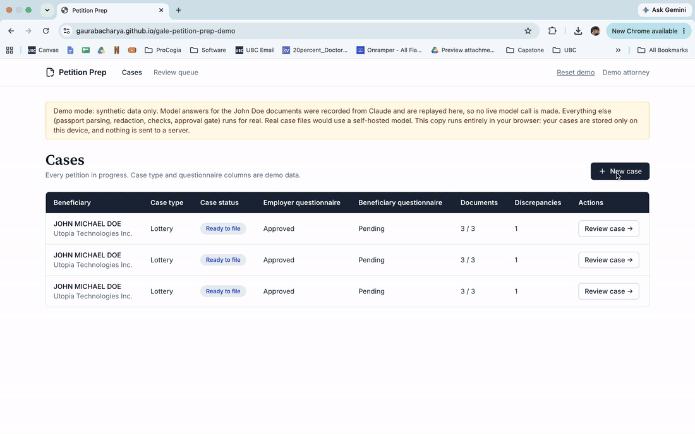

# Petition Prep



Petition Prep turns an employee's passport, degree and offer letter into attorney-approved H-1B petition data, without sending sensitive identifiers to a third-party model. The model drafts and extracts, deterministic code checks, and an attorney approves every fact before any output exists.

> **Demo mode: synthetic data only.** This build sends text to Claude via the Anthropic API. Real case files would use a self-hosted model.

For this demo I'm using Claude with fake data. In a real workflow, client documents would go to a local model running on our own servers, and the code is already built so that's a config switch.

**Try it:** https://gaurabacharya.github.io/gale-petition-prep-demo/ (runs entirely in your browser; see [In-browser demo](#in-browser-demo)).

## How it works

1. **Upload** a passport, a degree and an offer letter to a case.
2. **Extract.** The passport is parsed locally from its machine-readable zone (MRZ) with ICAO check digits validated, and never reaches a model. The degree and offer letter go through the model with sensitive identifiers tokenised first.
3. **Check.** Plain code compares the documents: missing documents, name mismatches, passport validity, MRZ digits, salary, and low-confidence fields. Judgement calls are left to the attorney.
4. **Review.** The attorney corrects and approves each fact beside its source quote.
5. **Output.** Once every fact is approved and no problem checks remain, generate the petition data sheet (PDF) and a support letter draft.

## Setup

Requires Node 20+. Postgres is optional (see below).

```bash
npm install
cp .env.example .env        # then fill in DATABASE_URL and ANTHROPIC_API_KEY
npm run migrate
npm run build:web           # builds the review UI into web/dist
npm start                   # API and UI on http://localhost:3000
```

No Postgres? Set `DATABASE_URL=pglite:./.pglite` in `.env` and skip `createdb`. The server applies migrations itself on startup. PGlite allows one process at a time, so stop the server before `npm run demo:reset`.


For UI development run `npm start` and `npm run dev:web` side by side (the Vite dev server proxies to the API).

### Environment variables

| Variable | Purpose |
| --- | --- |
| `LLM_PROVIDER` | `anthropic` (default), `selfhosted`, `replay` or `mock` |
| `ANTHROPIC_API_KEY` | Required for `anthropic` |
| `ANTHROPIC_MODEL` | Optional model override (default `claude-sonnet-5-5`) |
| `LLM_SERVER_URL` | Required for `selfhosted`: base URL of an OpenAI-compatible chat endpoint, such as vLLM |
| `LLM_MODEL` | Optional model name sent to the self-hosted server |
| `DEMO_MODE` | `true` by default. Rejects any passport whose MRZ country is not `UTO` |
| `DATABASE_URL` | Postgres connection string, or `pglite:./.pglite` for embedded Postgres with nothing to install (`pglite:memory` forgets everything on exit) |
| `PORT` | Server port (default 3000) |

## Run the demo with no API key

`LLM_PROVIDER=replay` plays back model answers that Claude wrote once for the John Doe documents (`src/demo/recorded.ts`), including the support letter. Only the model call is recorded; passport parsing, redaction, quote grading, the checks and the approval gate all run for real, and the UI banner says so. Documents other than John Doe's are refused with a clear message. Together with `DATABASE_URL=pglite:./.pglite` this runs anywhere Node does, which makes it the setting for a hosted demo that anyone can try. A sample of the finished outputs is in `docs/demo/output/`.

## Try it with the demo data

The demo beneficiary is **John Doe**, a fictional person with synthetic documents in `samples/`: a scanned specimen passport (`passport.png`, country `UTO`), a degree PDF and an offer letter PDF from a fictional employer.

**Guided:** on the Cases page click **+ New case**, name it (for example "Doe H-1B") and press Create. An **Add documents** pop-up opens over the case. Press **Fill example** to show John Doe's three files (each has a **View** link), then drag them onto the drop area one at a time, or press Add. Watch the processing stages (OCR for the passport scan, redaction and model extraction for the PDFs) while the facts fade into the table behind. You can also drag your own files in from the desktop. **Add documents** on any case reopens the pop-up.

**By hand:** create a case, then upload `samples/passport.png`, `samples/degree.pdf` and `samples/offer-letter.pdf`.

| Document | What it holds |
| --- | --- |
| Passport | `DOE`, `JOHN MICHAEL`, number `L898902C3`, expires 2027-01-15 |
| Degree | John Doe, Bachelor of Science in Computer Science, Utopia University |
| Offer letter | John Doe, Software Engineer at Utopia Technologies Inc., $95,000, starts October 1, 2026 |

The degree and offer letter omit the middle name and the passport expires within six months of the start date, so the checks show a name warning and a validity warning. Then review each fact, accept them all, and generate the outputs. `npm run samples` regenerates the files from `src/demo/sampleDocs.ts` (it draws the passport with a macOS system font, so run it on a Mac).

**Scans:** a PNG or JPEG passport is read by OCR (tesseract.js) on the server, with the language data bundled so nothing is fetched, and then parsed from its MRZ with the check digits validated. The image never goes to a model. OCR is only accepted for passports; other documents must be PDFs with a text layer or text files. The first scan takes a couple of seconds while the OCR worker starts.

To start a recording from a clean state, run `npm run demo:reset -- --yes`. It deletes every case and audit row in the database named by `DATABASE_URL`, and refuses to run when `DEMO_MODE=false`.

## Privacy layers

Each layer works on its own, so a mistake in one does not expose everything.

| Data | Handling | Model sees it? |
| --- | --- | --- |
| Passport (all fields) | Parsed locally from the MRZ, check digits validated | Never |
| SSN, A-number, passport no., date of birth, student ID, email, phone in other documents | Replaced with tokens like `[[SSN_1]]` before the call, restored after; the token vault stays in the server process | No, only the token |
| Names, job title, duties, salary | Needed for extraction, sent as is | Yes, which is why real cases use a self-hosted model |
| Support letter input | Only 11 facts; no passport number, date of birth or nationality | Minimal set |
| Audit log | Which model ran and how many values were redacted, never the values | Not applicable |

The model's prompt also tells it to treat document text as data and ignore instructions inside it.

## Demo vs. production

|  | Demo (now) | Production (real cases) |
| --- | --- | --- |
| Data | Synthetic samples only | Real client documents |
| Model | Claude via the Anthropic API | Open-weights model (for example Qwen 2.5) served with vLLM on a GPU server the firm controls |
| Where it runs | Anthropic's API | Private subnet in the firm's own cloud account |
| Privacy layers | MRZ parsing, redaction, audit log on | Same, unchanged |
| Switch | `LLM_PROVIDER=anthropic` | `LLM_PROVIDER=selfhosted` plus `LLM_SERVER_URL` |

The self-hosted provider is implemented and tested against a fake local server, but it is not deployed or used in the demo.

## Scripts

`npm test`, `npm run typecheck`, `npm run migrate`, `npm start`, `npm run dev:web`, `npm run build:web`, `npm run samples`, `npm run demo:reset -- --yes`.

## Out of scope

Filling the official I-129 PDF, OCR for scans, prevailing wage lookup, and multi-firm use. Filing with USCIS directly is not planned.

## In-browser demo

The GitHub Pages site runs the whole app in the visitor's browser, with no server:

- **Same API code.** `src/browser/inPageApi.ts` builds the same Hono app the Node server uses (`src/api/app.ts`) and answers the UI's `/cases`, `/fields` and `/status` requests inside the page (`src/browser/fetchRoute.ts`). The UI code is unchanged.
- **Database in the browser.** PGlite stores each visitor's cases in IndexedDB, so they survive a reload and are never shared. "Reset demo" in the nav empties them.
- **Replay answers.** The model calls use the recorded John Doe answers (`LLM_PROVIDER=replay`), so there is no API key and no model call.
- **Local OCR.** The passport scan is read with tesseract.js in the browser (`src/browser/ocr.ts`). The OCR worker, engine and English model are copied into the site, so nothing loads from a CDN.

Build and preview it locally:

```bash
npm run build:pages     # writes web/dist-pages
npm run preview:pages   # http://localhost:4173/gale-petition-prep-demo/
```

`.github/workflows/pages.yml` runs the type check, the tests and `build:pages` on every push to `main`, then publishes to GitHub Pages. One-time setup: in the repo's Settings → Pages, set Source to **GitHub Actions**.

